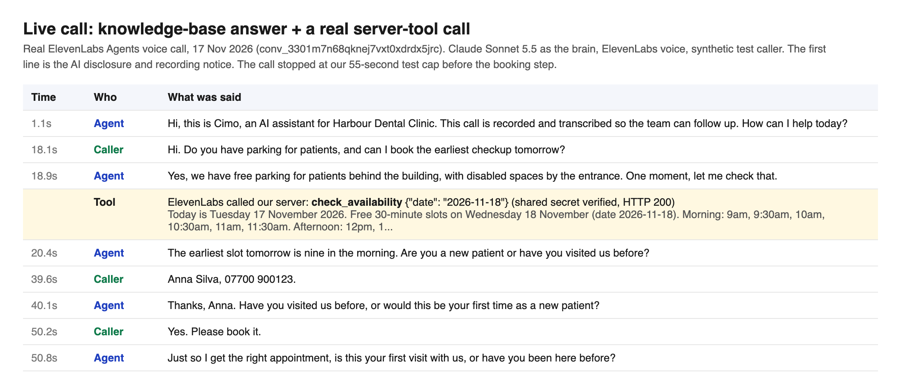
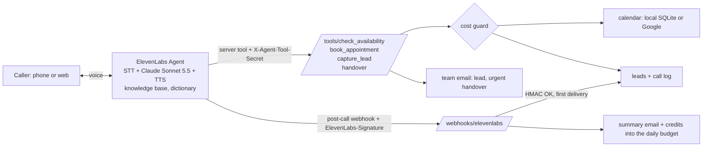
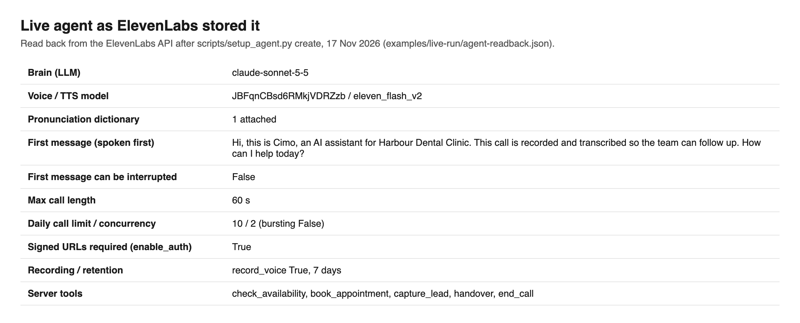
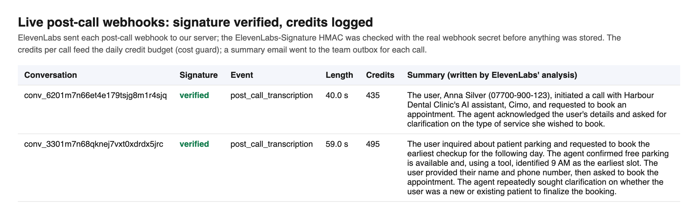
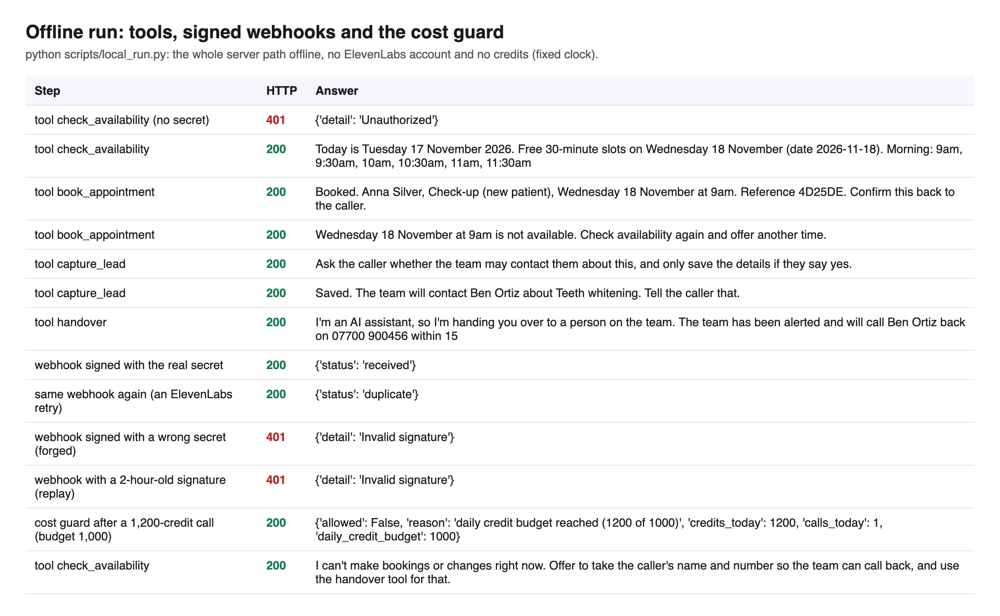

# ElevenLabs Claude Voice Agent

[](https://github.com/ParishSynthMind/elevenlabs-claude-voice-agent/actions/workflows/tests.yml)

A voice receptionist built on **ElevenLabs Agents** (Conversational AI) with **Claude** as the brain. It answers questions from a knowledge base, checks free slots and books them, captures leads (only with the caller's consent) and hands the caller over to a person, through **server tools** that ElevenLabs calls on your own backend. After every call ElevenLabs sends a **signed post-call webhook**; the server verifies it, logs the transcript, cost and outcome, and emails the team a summary.

Around it, the things a business needs before letting a voice bot talk to its customers:

- **AI disclosure and recording notice in the first line**, which the caller cannot talk over.
- **Cost guard** in three layers: ElevenLabs ends every call at a maximum length and refuses calls past a daily limit; the server adds up the credits each webhook reports and stops booking once a daily budget is reached; a kill switch pauses everything (on ElevenLabs' side too).
- **Pronunciation dictionary** so the agent says the business's names right, and a **narration / voice-over script** that uses the same voice and dictionary, with a hard character cap so a whole script is never sent by accident.
- **One setup script** that creates (and pauses, resumes, deletes) the agent, its tools, knowledge base, dictionary, webhook and workspace secret through the ElevenLabs API, so nothing is clicked together by hand.

<!-- LIVE-STATUS -->
**Status (18 Nov 2026): tested live on a real ElevenLabs account** (Creator plan, a separate API key limited to 7 scopes and a 3,000-credit cap). The agent was created entirely by `scripts/setup_agent.py` and read back from the API. **Two real voice calls** were made with a scripted synthetic caller: the AI disclosure was spoken first, Claude Sonnet 5.5 answered from the knowledge base, ElevenLabs called our **server tool** `check_availability` (secret header verified) and offered the 9am slot, and both **post-call webhooks** arrived with a valid `ElevenLabs-Signature` and were logged (435 and 495 credits). **Booking, lead capture and handover were tested by simulation**: the same server endpoints ElevenLabs called live, driven offline with ElevenLabs-format requests (see below), not over a real call. The narration script was only dry-run. Further live calls were skipped on purpose to save credits. 176 offline tests in CI.
<!-- /LIVE-STATUS -->



*Real call, 17 Nov 2026 (`examples/live-run/call2-client.json`, agent audio in `call2-agent-voice.m4a`). The test caller asked about parking and the earliest check-up: the agent answered from the knowledge base, called our `check_availability` tool and offered 9am. Claude then asked whether the caller was a new patient; the scripted caller had no line for that, so the 55-second test cap ended the call before the booking.*

## How it works



1. **The agent** (`voiceagent/agent_spec.py`): Claude Sonnet 5.5 as the LLM, an ElevenLabs voice on `eleven_flash_v2` (ElevenLabs only allows the turbo/flash v2 models for English agents; other languages get `eleven_flash_v2_5`), the clinic FAQ as a knowledge-base document, the pronunciation dictionary on the agent's TTS, the four server tools plus ElevenLabs' built-in `end_call`. The system prompt keeps it to the business, tells it never to give medical advice, to confirm details back and to use `handover` when unsure.
2. **First message** (`voiceagent/disclosure.py`): "Hi, this is Cimo, an AI assistant for Harbour Dental Clinic. This call is recorded and transcribed so the team can follow up. How can I help today?" Interruptions are switched off for it, so the disclosure is always heard in full (Vibe Coding Playbook rule B18). The line can only be removed with a written client request (`AI_DISCLOSURE_REMOVED_BY_WRITTEN_REQUEST`).
3. **Server tools** (`voiceagent/tools.py`, `POST /tools/{name}`): each tool request carries a secret header whose value ElevenLabs reads from a **workspace secret** (so the value is never in the agent config). Wrong or missing header: 401. ElevenLabs also passes the conversation id, so every booking, lead and handover is tied to its call.
   - `check_availability`: free 30-minute slots from opening hours minus existing bookings, with a minimum notice.
   - `book_appointment`: needs name, phone, date and time; refuses a slot that is taken; returns a reference to read back.
   - `capture_lead`: refuses to save anything until the caller has said yes to being contacted.
   - `handover`: emails the team (marked URGENT when it is) and tells the caller when they will be called back.
4. **Post-call webhook** (`POST /webhooks/elevenlabs`): `ElevenLabs-Signature: t=...,v0=...` is checked (HMAC-SHA256 of `timestamp.body` with the webhook secret, constant time, 30-minute tolerance) before anything is read. ElevenLabs retries failed deliveries, so each (conversation, event) is handled once; if processing fails the delivery is forgotten so the retry can try again. `call_initiation_failure` events raise an alert.
5. **Cost guard** (`voiceagent/costguard.py`): see above. When it trips, the tools answer "I can't make bookings right now, offer to take a message", so a caller is never left hanging.
6. **Narration** (`voiceagent/narration.py`, `scripts/narrate.py`): one text-to-speech request with a chosen voice, model and the dictionary; refuses anything over `NARRATION_MAX_CHARS` (default 600); `--dry-run` shows characters and estimated credits without sending; writes an `.mp3` and a sidecar `.json` labelled "AI-generated voice" with the voice, model, dictionary version and the credits measured from the account.



*Read back from the ElevenLabs API after `setup_agent.py create` (`examples/live-run/agent-readback.json`).*



*Both real calls' webhooks: signature verified with the real secret, length, credits and ElevenLabs' own call summary logged; a summary email went to the team outbox (`examples/live-run/summary-outbox.jsonl`).*

## Setup

```bash
python3.12 -m venv .venv && . .venv/bin/activate
pip install -r requirements.lock && pip install -e . --no-deps

# 1. An ElevenLabs API key with ONLY: Text to Speech, ElevenAgents (write), Voices (read),
#    Pronunciation Dictionaries (write), Models, User, Webhooks. Set a credit limit on the key.
security add-generic-password -s elevenlabs-api-key -a voiceagent -w   # macOS; or export ELEVENLABS_API_KEY

# 2. Run the server somewhere with public HTTPS (or a tunnel while testing)
ADMIN_TOKEN=... uvicorn voiceagent.main:app --port 8000

# 3. Create everything on ElevenLabs (preview first; nothing is sent with --dry-run)
python scripts/setup_agent.py create --server-url https://your-server.example.com --dry-run
python scripts/setup_agent.py create --server-url https://your-server.example.com
#    The tool secret and the webhook secret go straight to the Keychain (never printed);
#    restart the server so it reads them (AGENT_TOOL_SECRET, ELEVENLABS_WEBHOOK_SECRET).

python scripts/setup_agent.py status    # credits used, call limits as ElevenLabs has them
python scripts/setup_agent.py pause     # kill switch on ElevenLabs' side
python scripts/setup_agent.py delete    # agent, tools, knowledge base, webhook, secret
```

Settings are environment variables (`voiceagent/config.py`): business name, agent name, timezone, opening hours, slot length, `MAX_CALL_SECONDS`, `DAILY_CALL_LIMIT`, `DAILY_CREDIT_BUDGET`, `RECORD_AUDIO`, `RETENTION_DAYS`, `VOICE_ID`, `AGENT_LLM`, calendar backend (local SQLite or Google Calendar with a service account), team email (SMTP, or a local outbox file). Swap `data/knowledge_base.md` and `data/pronunciation.json` for the client's own.

To phone the agent, connect a Twilio number or a SIP trunk to it in the ElevenLabs dashboard (not done in this build, see limits). Web calls work through a signed URL (`enable_auth` is on, so nobody can start a call without one).

## Try it without any account

```bash
pytest -v                       # 176 tests, ElevenLabs faked at the HTTP layer
python scripts/local_run.py     # the whole server path offline -> examples/local-run/run.json
```



*`scripts/local_run.py` (also run in CI): a tool call without the secret is refused; a booking is made and the same slot refused; a lead is refused until consent, then saved; an urgent handover; a signed webhook accepted, its retry ignored, a forged one and a 2-hour-old replay refused; a 1,200-credit call trips the 1,000-credit budget and the next tool call politely declines.*

## What was proven live and what was mocked

| Part | Status |
|---|---|
| Agent, 4 webhook tools, workspace secret, knowledge base, pronunciation dictionary, post-call webhook, all created by `setup_agent.py` through the ElevenLabs API | **Proven live** 17 Nov 2026, read back from the API (`agent-readback.json`) |
| Real voice call: disclosure first (uninterruptible), Claude Sonnet 5.5 answers from the knowledge base, ElevenLabs speech-to-text gets name and phone number right | **Proven live**, 2 calls (`call1-client.json`, `call2-client.json`, agent audio `.m4a`) |
| ElevenLabs calling our server tool with the secret header | **Proven live**: `check_availability` on call 2, HTTP 200 (`server-tool-events.json`, `server.log`); a request without the header got 401 through the same public URL |
| Post-call webhook with `ElevenLabs-Signature` | **Proven live**: both calls, verified with the real secret, logged with credits (`server-calls.json`, `server-webhook-events.json`) |
| Max call length, daily call limit, concurrency, signed URLs only, kill switch | **Proven live** as settings ElevenLabs accepted and returned; `pause` (daily limit 0, concurrency 0) applied and read back 18 Nov 2026 |
| Booking, lead capture with consent, handover | **Tested by simulation**, not over a real call: the same endpoints ElevenLabs called live, driven offline through the real FastAPI app (`scripts/local_run.py`, in CI) and in tests. More live calls were skipped to save credits |
| Narration with the dictionary (text to speech) | **Never run live** (dry runs and tests only, to save credits); the request shape is tested against a fake |
| Calendar | Local SQLite live; Google Calendar adapter tested against a fake only |
| Phone numbers (Twilio / SIP) | Not connected; calls were web calls over the agent WebSocket |
| Hosting | Run from a Mac through a temporary cloudflared tunnel for the test; no permanent host |

**Credits used by the live test:** 930 for the two calls (435 + 495, as reported by ElevenLabs in the webhooks).

### Found live (and fixed)

- ElevenLabs refuses `eleven_flash_v2_5` for English agents ("English Agents must use turbo or flash v2"). The spec now picks `eleven_flash_v2` for English. `setup_agent.py create` saves every ID as it goes, so the failed first attempt resumed without making duplicates.
- The agent's audio arrives faster than real time. The first test caller replied as soon as audio stopped arriving, i.e. during the (uninterruptible) greeting, and its line was dropped. The client now tracks when the audio would finish *playing* (`voiceagent/callclient.py`, tested).
- Claude asks clarifying questions a fixed script does not expect ("new or existing patient?"). Test scripts now give those details up front.

## Honest limits

- A portfolio build, never used for a client. The clinic is fictional; callers were synthetic (macOS speech).
- Only web calls were made; telephony (Twilio, SIP) is configured in ElevenLabs and was not tested here.
- English only as configured; other languages need their own knowledge base, prompt and disclosure line.
- ElevenLabs Agents bills per minute and passes the LLM cost through. Set `MAX_CALL_SECONDS`, `DAILY_CALL_LIMIT`, `DAILY_CREDIT_BUDGET` and a per-key credit limit before going live.
- The client's agent belongs on the client's own ElevenLabs account, not ours.
- Recording personal data on calls has legal duties (consent, retention, access requests). The notice and the retention setting are there; the client's lawyer decides what the wording must be.

## Security

- **Tools:** shared secret header, value held as an ElevenLabs workspace secret and in our Keychain/env, constant-time compare; request bodies capped.
- **Webhooks:** HMAC checked before parsing, stale timestamps refused, duplicate deliveries ignored. The check is cross-tested against ElevenLabs' own SDK.
- **Calls:** `enable_auth` on, so a call needs a signed URL from our key; no bursting over the concurrency limit.
- **No personal data in logs:** tool logs say only which tool answered and how long the answer was.
- **Secrets** from env or the Keychain only; the setup script stores generated secrets and never prints them; `.env`, `var/` and databases are git-ignored.
- **Least access:** the API key has 7 scopes and its own credit limit; admin endpoints (`/calls`, `/leads`, `/guard`) need a bearer token.
- **Dependencies pinned** (`requirements.lock`), `pip-audit` in CI: 0 known vulnerabilities (17 and 18 Nov 2026). Actions pinned to commit SHAs.
- **Failure alerts:** a webhook that fails to process, a call that fails to start, a tool error and the budget tripping all alert (heartbeat template: webhook, email or stderr).

## Versions (pinned on purpose)

| Platform | Version pinned | Where | Vendor end date | Review |
|---|---|---|---|---|
| ElevenLabs API | `v1` REST + agent WebSocket (no dated versions) | `voiceagent/elevenlabs_api.py` | none published | 2027-02 |
| ElevenLabs TTS model | `eleven_flash_v2` (English agent), `eleven_flash_v2_5` (narration, other languages) | `voiceagent/config.py` | none announced | 2027-02 |
| Claude model (inside ElevenLabs) | `claude-sonnet-5-5` | `AGENT_LLM` | none announced | 2027-02 |
| Python | 3.12 (CI) | `.github/workflows/tests.yml` | 2028-10 | 2027-10 |

## When something breaks (Tier 1 runbook)

| Symptom | Likely cause | Fix |
|---|---|---|
| Agent says it can't check or book; server log shows 401 on `/tools/...` | Tool secret differs between ElevenLabs and the server | `setup_agent.py update --rotate-secret` (new value on ElevenLabs and in the Keychain, never printed), then restart the server |
| Every webhook gets 401 | Webhook secret changed or wrong workspace | Copy the secret from ElevenLabs Developers > Webhooks into `elevenlabs-webhook-secret`; restart |
| No webhooks at all | ElevenLabs disabled the webhook after repeated failures, or the server URL changed | Re-enable it in the dashboard; if the URL moved, `delete` and `create` (the webhook URL is fixed at creation) |
| Calls refused / "limit reached" | Daily call limit, or the agent is paused | `setup_agent.py status`; `resume` if paused on purpose; raise `DAILY_CALL_LIMIT` only with the client's OK |
| Agent declines to book, says to take a message | Cost guard tripped (daily credit budget) | `GET /guard`; the budget resets at midnight local time; `POST /guard/resume` only after checking spend |
| `agents/create` 400 about the TTS model | English agent on a non-v2 model | Keep `eleven_flash_v2` for English |
| Agent mispronounces a name | Missing dictionary rule | Add an alias rule to `data/pronunciation.json`, `setup_agent.py update` |
| Errors about the LLM | Model id retired | Change `AGENT_LLM` to a current Claude id from ElevenLabs' supported list, `update` |

## Tests

176 offline tests: webhook signatures (including a cross-check against the official `elevenlabs` SDK), tool secret, the four tools, scheduling and both calendars, the cost guard, disclosure and settings validation, the agent spec, the API client against a fake ElevenLabs (retries on 408/429/5xx with `Retry-After`), the pronunciation dictionary and narration caps, the test-call client and the setup script (create, resume after a failure, update, secret rotation, pause, delete).

```bash
ruff check . && pytest -v
```

Scheduling, calendar and notification code is adapted from this account's [retell-ai-receptionist](https://github.com/ParishSynthMind/retell-ai-receptionist).

## Licence

MIT. Built by ParishSynthMind with Claude Code.
